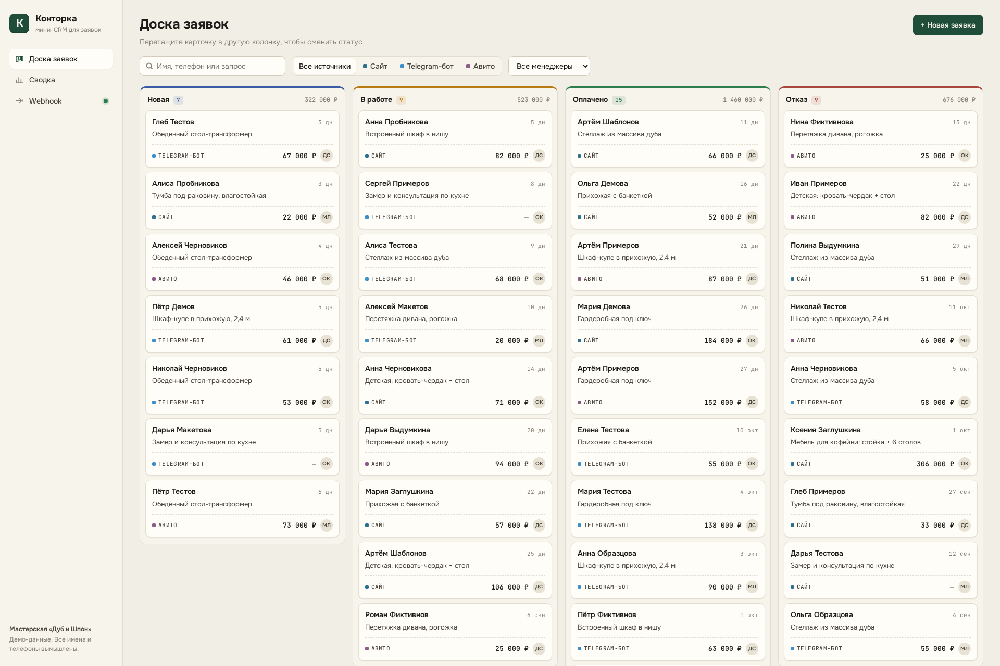
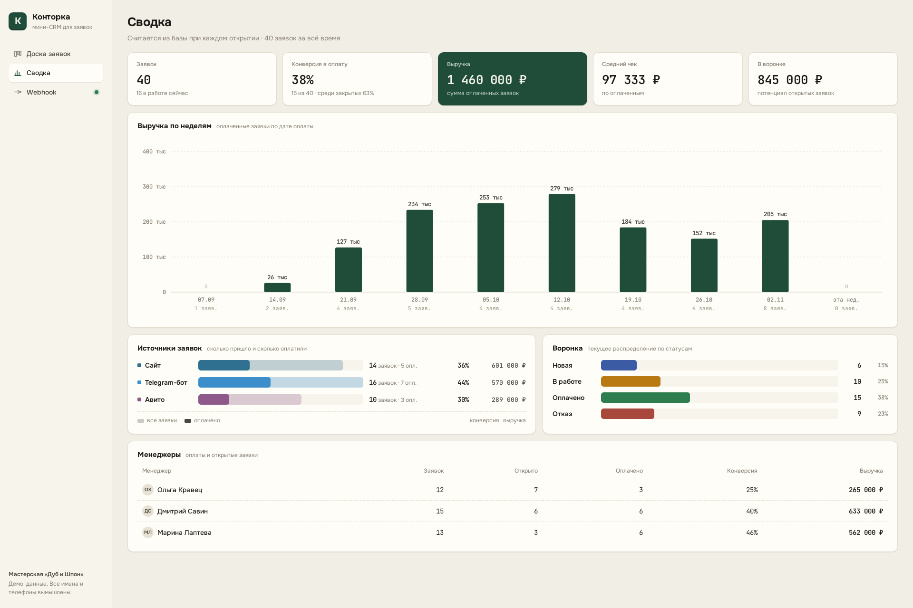
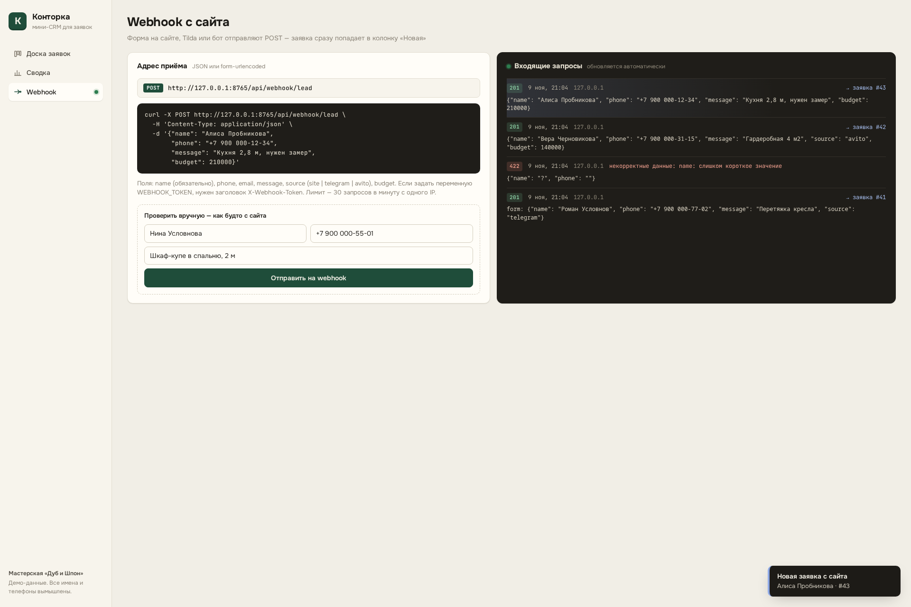

# Конторка — мини-CRM для заявок

Демо-проект: небольшая CRM для мастерской или студии, куда сходятся заявки с сайта, из Telegram-бота и с Авито.
Заявка проходит по воронке **Новая → В работе → Оплачено / Отказ**. Каждое действие пишется в историю.

## Скриншоты






Все имена, телефоны и e-mail в демо-данных вымышлены (фамилии вроде Тестов, Примерова, Заглушкин; телефоны `+7 900 000-…`; почта `@example.com`).

## Что умеет

- **Канбан-доска.** Карточку можно перетащить в другую колонку, новый статус сразу пишется в SQLite. Поиск по имени, телефону и тексту запроса, фильтры по источнику и менеджеру. В шапке колонки — количество заявок и сумма.
- **Карточка заявки.** Смена статуса, правка суммы и ответственного, комментарии. Полная история: кто, когда и что изменил.
- **Сводка.** Цифры считаются из базы при каждом открытии: число заявок, конверсия в оплату (от всех заявок и среди закрытых), выручка, средний чек, сумма открытых заявок. Есть график выручки по неделям, разбивка по источникам с конверсией и выручкой, воронка и таблица по менеджерам.
- **Публичный webhook** `POST /api/webhook/lead` для формы на сайте, Tilda или бота. Принимает JSON и `application/x-www-form-urlencoded`. Каждый запрос попадает в журнал, ошибочные тоже. Открытый интерфейс раз в 3 секунды проверяет журнал: новая заявка появляется на доске и показывается всплывающим уведомлением.
- **Защита webhook.** Необязательный токен (`WEBHOOK_TOKEN` → заголовок `X-Webhook-Token`), лимит 30 запросов в минуту с одного IP, ограничение размера тела запроса, валидация полей через Pydantic.

## Стек

- **Backend:** Python 3.11+, FastAPI, SQLite (модуль `sqlite3`, SQL только с параметрами), Pydantic.
- **Frontend:** обычный HTML, CSS и JavaScript (ES-модули), сборка не нужна. Drag-and-drop на HTML5, графики на SVG без библиотек. Шрифты Onest и JetBrains Mono берутся из Google Fonts; без интернета подставятся системные.
- **Тесты:** pytest + FastAPI TestClient (13 тестов: webhook, валидация, токен, лимит, статусы, история, фильтры, статистика, сид).

```
app/
  main.py      маршруты API и webhook, раздача статики
  repo.py      доступ к данным: заявки, история, журнал webhook
  stats.py     расчёт сводки
  schemas.py   валидация входных данных
  db.py        схема SQLite, справочники статусов, источников и менеджеров
static/        интерфейс (index.html, style.css, js/*.js)
seed.py        генератор демо-данных
tests/         pytest
```

## Запуск

```bash
python -m venv .venv && source .venv/bin/activate     # fish: source .venv/bin/activate.fish
pip install -r requirements.txt

python seed.py                       # пересоздаёт data/crm.sqlite3 с 40 демо-заявками
uvicorn app.main:app --port 8765     # открыть http://127.0.0.1:8765
```

Тесты: `python -m pytest -q`

Переменные окружения:

| Переменная | По умолчанию | Назначение |
|---|---|---|
| `CRM_DB` | `data/crm.sqlite3` | путь к базе |
| `WEBHOOK_TOKEN` | не задан | если задан, webhook требует заголовок `X-Webhook-Token` |
| `WEBHOOK_LIMIT_PER_MIN` | `30` | лимит запросов к webhook с одного IP |

## Проверка webhook

```bash
curl -X POST http://127.0.0.1:8765/api/webhook/lead \
  -H 'Content-Type: application/json' \
  -d '{"name": "Алиса Пробникова", "phone": "+7 900 000-12-34", "message": "Кухня 2,8 м", "budget": 210000}'
# {"ok":true,"lead_id":41}
```

Поля: `name` (обязательно, от 2 символов), `phone`, `email`, `message`, `source` (`site` | `telegram` | `avito`, по умолчанию `site`), `budget`.

## API

| Метод | Путь | Что делает |
|---|---|---|
| GET | `/api/meta` | статусы, источники, менеджеры |
| GET | `/api/leads?status=&source=&manager=&q=` | список заявок с фильтрами |
| POST | `/api/leads` | создать заявку вручную |
| GET | `/api/leads/{id}` | заявка и её история |
| PATCH | `/api/leads/{id}/status` | сменить статус: `{"status": "paid"}` |
| PATCH | `/api/leads/{id}` | изменить сумму и/или ответственного |
| POST | `/api/leads/{id}/comments` | добавить комментарий |
| GET | `/api/stats?weeks=10` | сводка для дашборда |
| POST | `/api/webhook/lead` | публичный приём заявок |
| GET | `/api/webhook/log?after_id=` | журнал запросов к webhook |

Интерактивная документация: `http://127.0.0.1:8765/docs`.

## Ограничения демо

- Нет авторизации и ролей: все действия идут от имени ответственного менеджера. Перед реальным использованием API и интерфейс нужно закрыть логином.
- Новые заявки приходят через опрос сервера (polling) раз в 3 секунды, а не через WebSocket.
- Лимит запросов хранится в памяти процесса. При нескольких воркерах его нужно перенести в Redis.
- SQLite подходит для одной небольшой команды. Для роста предусмотрен перенос на PostgreSQL.
- Drag-and-drop работает мышью. На телефоне статус меняется кнопками в карточке заявки.
